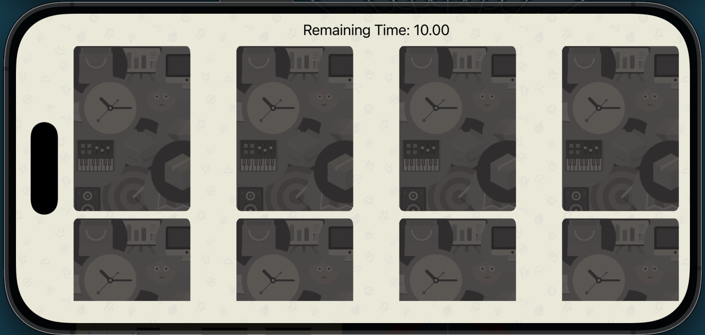
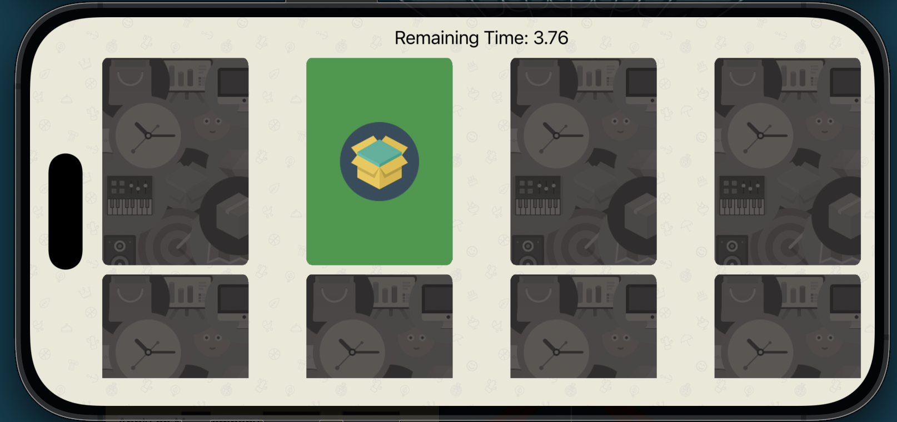

#  Card Match Game

## 📱 Project Overview
Card Match is a memory-based iOS game developed using **Swift** and **UIKit**.  
The player flips cards to find matching pairs within a limited time.  
The timer starts only when the user taps the first card, making the gameplay fair and user-friendly.

This project demonstrates core iOS concepts like `UICollectionView`, reusable cells, animations, timers, and game state management.

---

## 📸 Screenshots

  
  

---
## 🚀 Features
- Card flip animation (front & back)
- Timer starts on first card tap
- Match checking logic
- Automatic flip-back for unmatched cards
- Matched cards are removed with animation
- Win & lose alerts
- Restart game functionality
- Handles UICollectionView cell reuse properly

---

## 🛠️ Tech Stack
- **Language:** Swift
- **Framework:** UIKit
- **UI Components Used:**
  - UICollectionView
  - UICollectionViewCell
  - UILabel
  - UIAlertController
- **Architecture:** MVC
- **Animations:** UIView animations
- **Timer:** `Timer` with RunLoop

---
